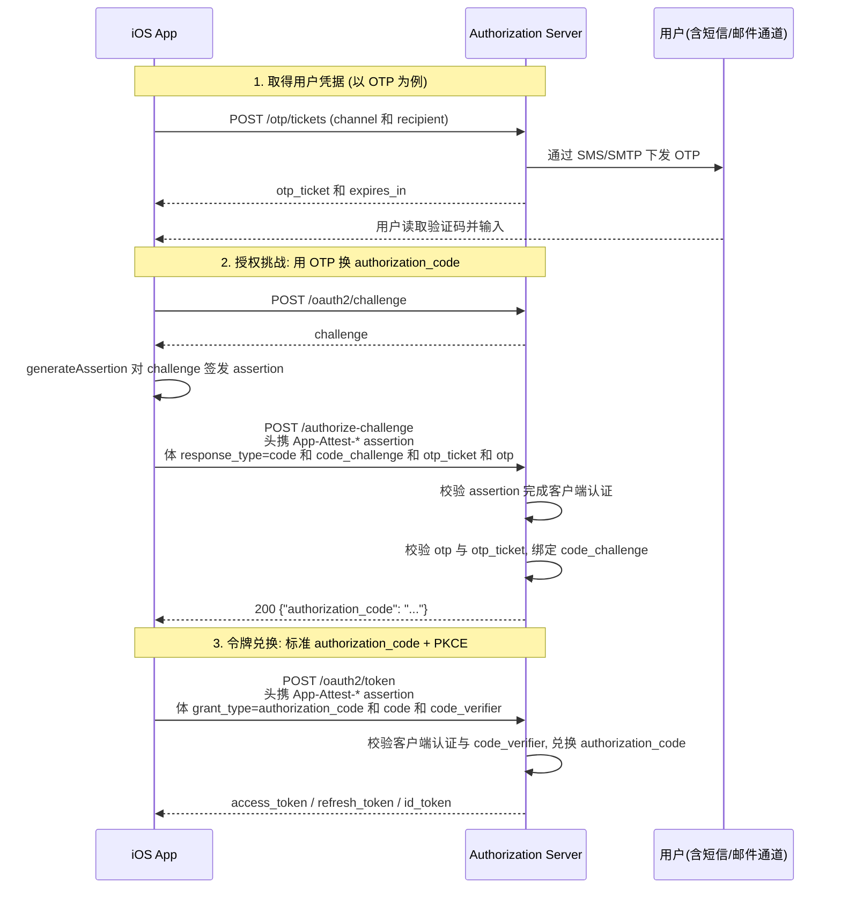

# OAuth 2.0 for First-Party Apps (授权挑战端点)

本文档描述认证服务对 [OAuth 2.0 for First-Party Applications (draft-ietf-oauth-first-party-apps)](https://datatracker.ietf.org/doc/draft-ietf-oauth-first-party-apps/) 的支持: 一个无浏览器的**授权挑战端点** `POST /authorize-challenge`. 第一方原生 App 用它把一次用户认证直接换成标准 `authorization_code`, 再走标准 `authorization_code` + PKCE 换取 Token, 全程无需拉起浏览器.

与经典的浏览器重定向授权码流程相比, 授权挑战端点替代的是"用户在浏览器里完成认证并 302 回 `redirect_uri` 带上 `code`"这一步: 客户端改为在后端信道直接 `POST` 用户凭据, 服务端校验通过后**以 JSON 直接返回 `authorization_code`**. 拿到 `authorization_code` 之后的令牌兑换与标准授权码流程完全一致.

---

## 一. 适用场景与前提

- **第一方原生 App**: 客户端与认证服务同属一方, 用户理解为同一品牌. 该端点让客户端直接与用户交互, 因此只适用于这种高信任场景.
- **客户端认证**: 请求须携带 Apple App Attest assertion 完成客户端认证 (与令牌端点一致). 详见 [Attestation Based Client Authentication (Apple App Attest)](OAuth2-Client-Authentication-%23-Attestation-Based-%23-Apple-App-Attest.md).
- **客户端注册要求**:
  - `grant_types` 含 `authorization_code`;
  - `token_endpoint_auth_method` 为 `attest_appattest_client_auth` (即以 attestation 作为客户端认证方法);
  - `require_proof_key` 为 `true` 时, 挑战请求必须携带 `code_challenge`;
  - 注册 `authorization_code` grant 需登记至少一个 `redirect_uri` (客户端注册的固有校验; 本流程自身不重定向, 该 `redirect_uri` 不参与授权挑战请求与令牌请求).

> ⚠️ 以 `none` 为 `token_endpoint_auth_method` 的公开客户端 (无论是否附带 attestation) **不支持**本端点: 缺少 `code_verifier` 会被拒 (`invalid_grant`). 第一方 App 应以 attestation 作为客户端认证方法注册.

---

## 二. 端点发现

授权挑战端点经授权服务器元数据发现, 默认路径 `POST /authorize-challenge`:

```
GET {issuer}/.well-known/openid-configuration#authorization_challenge_endpoint
```

同一成员也出现在 OAuth 2.0 Authorization Server Metadata 文档中.

---

## 三. 流程总览



---

## 四. 授权挑战请求: `POST /authorize-challenge`

### 4.1 请求

```http
POST /authorize-challenge
Content-Type: application/x-www-form-urlencoded
App-Attest-Kid: {kid}
App-Attest-Challenge: {challenge}
App-Attest-Assertion: {Base64(Assertion Object)}

response_type=code
&scope=openid
&code_challenge={S256(code_verifier)}
&code_challenge_method=S256
&otp_ticket={otp_ticket}
&otp={用户输入的验证码}
```

请求头承载 Apple App Attest 客户端认证凭据, 请求体承载授权请求参数:

| 参数 | 必选 | 说明 |
|---|---|---|
| `response_type` | 是 | 固定为 `code`. |
| `client_id` | 否 | 客户端已由 attestation 认证识别; 若携带则必须与认证出的客户端一致, 否则拒绝. |
| `scope` | 否 | 空格分隔. 省略时回落到客户端注册的全部 `scope`. |
| `code_challenge` | 视情况 | PKCE code challenge (RFC 7636). 客户端 `require_proof_key=true` 时**必填**. |
| `code_challenge_method` | 视情况 | 携带 `code_challenge` 时必填, 且必须为 `S256`. |
| `otp_ticket` | 是 | `POST /otp/tickets` 返回的会话句柄. |
| `otp` | 是 | 用户输入的验证码. |

> 本端点**不接收** `redirect_uri`: 流程无重定向, 令牌兑换时也不携带 `redirect_uri`.

### 4.2 成功响应

```http
HTTP/1.1 200 OK
Content-Type: application/json
Cache-Control: no-store

{
  "authorization_code": "uY29tL2F1dGhlbnRpY"
}
```

| 字段 | 类型 | 含义 |
|---|---|---|
| `authorization_code` | string | 授权码. 客户端随后在令牌端点作为标准 `code` 参数提交. |

### 4.3 错误响应

失败时返回 HTTP 400 与标准 OAuth 2.0 错误 JSON:

```http
HTTP/1.1 400 Bad Request
Content-Type: application/json
Cache-Control: no-store

{
  "error": "invalid_grant",
  "error_description": "OTP verification failed"
}
```

| `error` | 触发情形 |
|---|---|
| `invalid_client` | 请求未携带 attestation, 或 attestation 校验失败. |
| `invalid_request` | 缺少 / 非法参数, 如 `response_type` 非 `code`、`client_id` 与认证客户端不一致、`require_proof_key` 客户端缺 `code_challenge`、`code_challenge_method` 非 `S256`. |
| `invalid_scope` | 请求的 `scope` 超出客户端注册范围. |
| `unauthorized_client` | 客户端未注册 `authorization_code` grant. |
| `invalid_grant` | OTP 校验失败 (验证码错误 / 过期 / `otp_ticket` 已使用). |

---

## 五. 令牌兑换: `POST /oauth2/token`

用授权挑战端点返回的 `authorization_code` 走标准授权码 grant 换取 Token. 请求同样以 App Attest assertion 完成客户端认证, 并携带与 `code_challenge` 配对的 `code_verifier`; **不携带 `redirect_uri`** (授权挑战请求未包含它).

```http
POST /oauth2/token
Content-Type: application/x-www-form-urlencoded
App-Attest-Kid: {kid}
App-Attest-Challenge: {challenge}
App-Attest-Assertion: {Base64(Assertion Object)}

grant_type=authorization_code
&code={authorization_code}
&code_verifier={code_verifier}
```

成功响应为标准令牌响应 (含 `access_token` / `token_type` / `expires_in`, 以及注册了相应 grant 与 scope 时的 `refresh_token` / `id_token`):

```json
{
  "access_token": "eyJhbGciOiJSUzI1NiIsInR5cCI6IkpXVCJ9...",
  "token_type": "Bearer",
  "expires_in": 3599,
  "refresh_token": "8xLOxBtZp8eNq7WmY3sQ1vC5yR2tG4zH",
  "scope": "openid",
  "id_token": "eyJhbGciOiJSUzI1NiIsInR5cCI6IkpXVCJ9..."
}
```

> `authorization_code` 单次使用; 重复兑换或 `code_verifier` 与 `code_challenge` 不匹配均返回 `invalid_grant`.

---

## 六. PKCE

PKCE 分两段, 与经典授权码流程一致:

- **授权挑战端点**: 注册 `code_challenge`. 携带时必须使用 `S256`; 客户端 `require_proof_key=true` 时必须携带.
- **令牌端点**: 校验 `code_verifier` 与先前注册的 `code_challenge` 是否匹配.

授权挑战端点不校验 `code_verifier` (此刻 `authorization_code` 尚未签发), 正如浏览器授权端点也不校验它.

---

## 七. 用户认证扩展

授权挑战端点把"客户端认证"与"用户认证"解耦: 客户端认证固定为 App Attest attestation, 用户认证以扩展参数承载. 当前实现支持一种用户认证方式:

| 用户认证 | 扩展参数 | 凭据来源 |
|---|---|---|
| 短信 / 邮箱 OTP | `otp_ticket` + `otp` | `POST /otp/tickets`, 详见 [App Attest 登录 - OTP 接入细节](app-attest-login/v2/App-Attest-Login-%23-OTP.md) |

草案定义的以下能力属可扩展点, **本期未实现**:

- `auth_session` 与多步 `insufficient_authorization` (分多次收集用户信息);
- `redirect_to_web` (回退到浏览器授权码流程);
- DPoP 授权码绑定等发送方约束令牌.

---

## 八. 相关文档

- [Attestation Based Client Authentication (Apple App Attest)](OAuth2-Client-Authentication-%23-Attestation-Based-%23-Apple-App-Attest.md) — 客户端认证契约
- [OAuth2 Client Registration - App Attest DYNAMIC](OAuth2-Client-Registration-%23-App-Attest-Dynamic.md) — RFC 7591 动态客户端注册契约
- [Apple App Attest 登录完整流程文档](app-attest-login/v2/App-Attest-Login.md) — App Attest 登录上位流程
- [App Attest 登录 - OTP 接入细节](app-attest-login/v2/App-Attest-Login-%23-OTP.md) — OTP 用户凭据获取
- [OAuth 2.0 for First-Party Applications (Draft)](https://datatracker.ietf.org/doc/draft-ietf-oauth-first-party-apps/) — 本端点遵循的规范
- [RFC 7636: Proof Key for Code Exchange (PKCE)](https://datatracker.ietf.org/doc/html/rfc7636)
